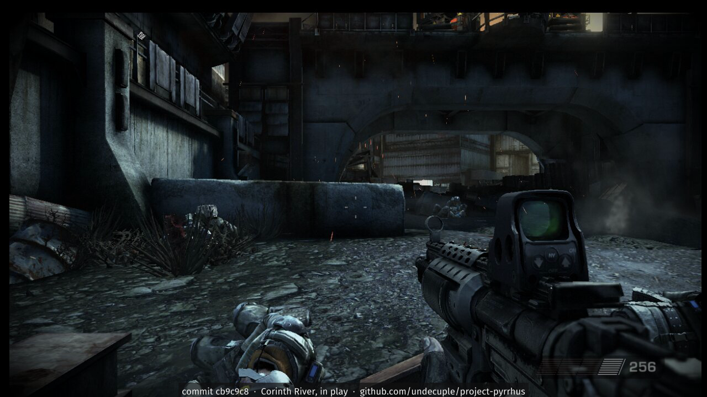
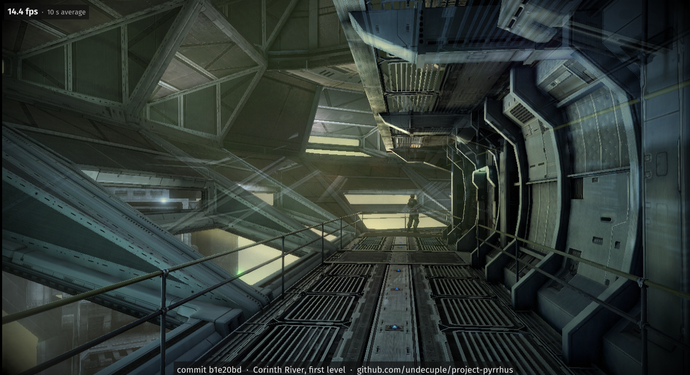
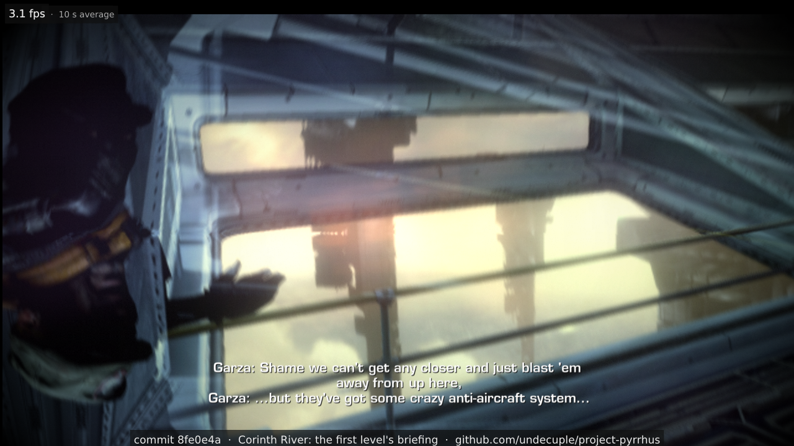
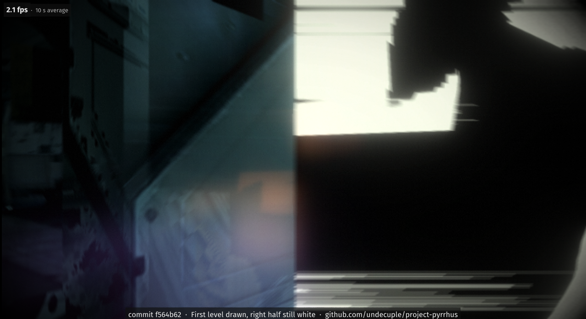
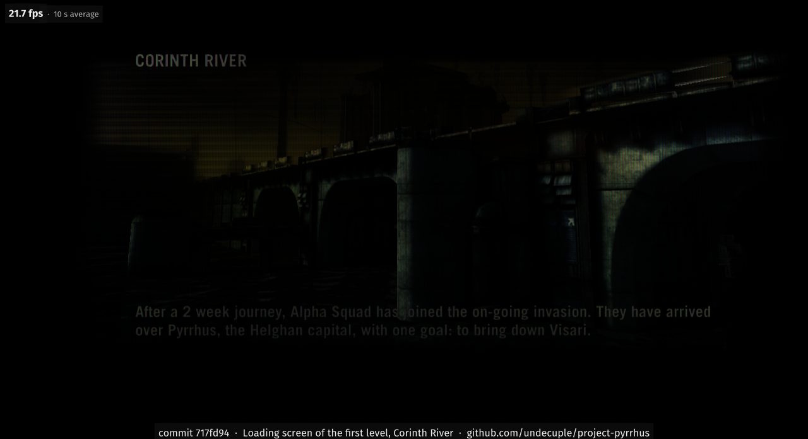
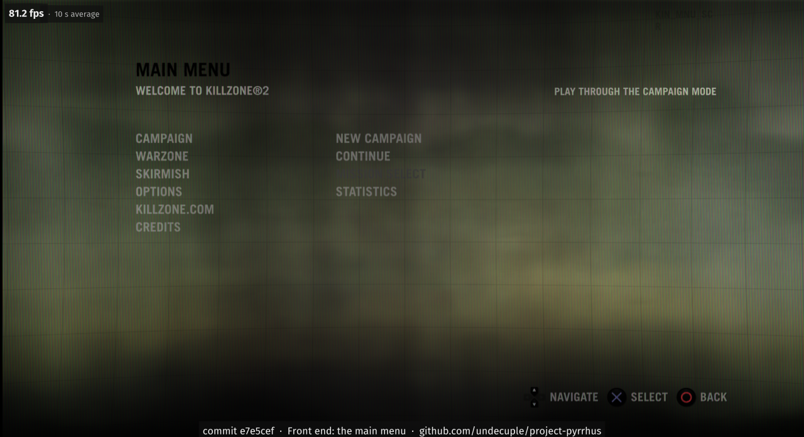

# Screenshots

Screenshots of the port running, one per milestone, newest first, picked from the dated screenshots taken during
development. Each image carries a bar with the commit of the build it was taken on, what it shows and the project
link; up to 2026-10-20 a top-left box gives the frame rate over the last 10 seconds before the shot, from the run's
own frame log. Each frame rate is that build's own, so early screenshots show early speeds; later screenshots carry
no frame rate (see the README's Status for the measured numbers).

**Test machine:** Intel Core i7-12700KF, NVIDIA GeForce RTX 4060, the Windows x64 build run under GE-Proton11-7 on
Linux; the game renders at 1280x720.

The game's imagery in these screenshots is © Sony Interactive Entertainment, shown only to document the port (see
[NOTICE.md](../NOTICE.md)). They come from the developer's own copy of the game.

## 2026-10-28 · The first level in play

The first level (Corinth River) in play from a scripted pad run, a few minutes in: the player's weapon, the crosshair
and the ammo counter are drawn, and the level runs with its effects (sparks and smoke). This frame is taken from a
recording of the run.

## 2026-10-20 · The first level at about 14 frames per second

A walkway in the first level (Corinth River) at the end of a 330-second unattended run, motion blur off. This build ran
the level at about 17 frames per second over the run (14.4 in the last 10 seconds; the PS3 runs it at 30): the
translated SPU code is now built for SSE4.1 and FMA, and characters are lit again (an SPU float-range fix), where the
earlier build drew them as dark silhouettes.

## 2026-10-20 · The first level drawn

The opening of the first level (Corinth River) at the end of a 330-second unattended run: the view through the window
during the briefing, lit and with its subtitles. This build ran the level at about 3.4 frames per second over the run
(3.1 in the last 10 seconds; the PS3 runs it at 30; later builds reach about 4). Moving images still look soft or doubled here: the game's motion
blur is tuned for 30 frames per second, and later builds switch it off by default until the port runs near full
speed.

## 2026-10-19 · The first level's first picture

The first time the first level (Corinth River) drew a recognisable picture, at the end of a 330-second unattended run,
after a fix to the game's job scheduling let the level's entities update. The build ran at about 2.6 frames per second
over the run (2.1 in the last 10 seconds; the PS3 runs it at 30). The right half of the screen is solid white with torn
edges and nothing is lit properly yet; later fixes to the game's antialiased surfaces removed the white half.

## 2026-10-13 · The first level's loading screen

A scripted pad run took the port from the main menu through New Campaign and the difficulty choice to the loading
screen of the first level, Corinth River, with the mission text (21.7 frames per second in the last 10 seconds, a
loading screen; the PS3 runs the game at 30). The level itself did not start yet: after this screen the game stopped
in its first physics step and the window stayed black.

## 2026-10-13 · The main menu

The front end running: the game's own menu pages are read from its archive and drawn (the page engine only worked after
a PowerPC string-copy instruction was implemented in the translator). The 81 frames per second shown is a menu with no
scene to draw; the PS3 runs at 30. The selected entry had no highlight yet, and no pad was tested.
